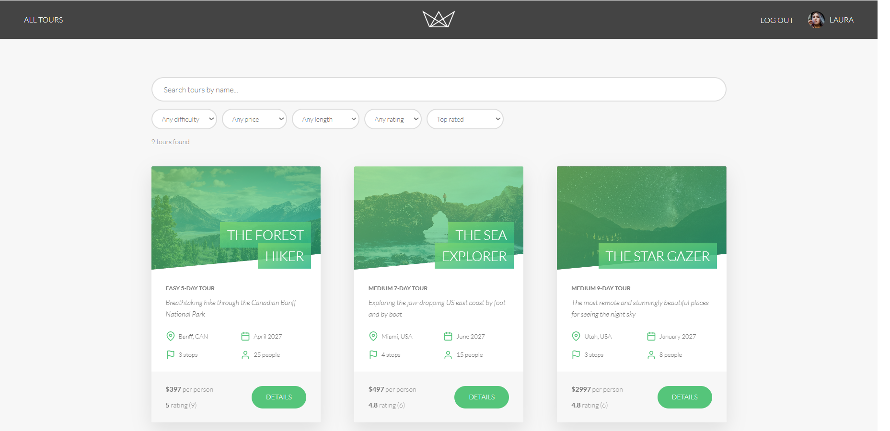
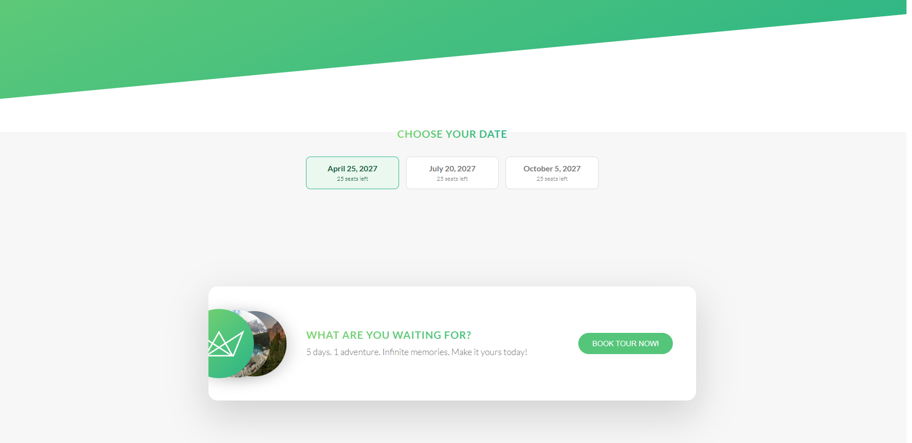
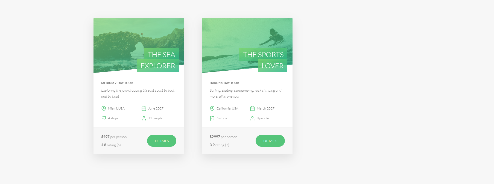

# Natours React

A full-stack tour booking app. It started as Jonas Schmedtmann's Natours course project (Express + MongoDB + Pug). I rebuilt the frontend as a React single-page app, separated it from the API, and added features on top: seat-aware bookings, automatic refunds, a Stripe webhook, verified reviews, search with filters, and an admin dashboard.

**Live demo:** https://natours-react.onrender.com

> The demo runs on Render's free tier, so the first request after a period of inactivity can take about a minute while the server wakes up. Payments run in Stripe **test mode**, so no real money is charged.

## Screenshots

| Overview (search, filters, sort)           | Tour page (dates and seats)        |
| ------------------------------------------ | ---------------------------------- |
|  |  |

**My Tours**



## Features

- **Authentication:** signup, login, logout, forgot/reset password by email, JWT in an httpOnly cookie, protected routes, session kept across refresh
- **Account:** update name, email and photo (multipart upload), change password
- **Search, filters, sort, pagination:** text search plus difficulty, max price, max duration and min rating filters in a dropdown panel. All state lives in the URL, so views survive a refresh and can be shared.
- **Seat-aware booking:** every tour date has a limited number of seats, shown on the tour page. Cards show "sold out" and "few seats left" ribbons.
- **Race-safe seat claiming:** a seat is claimed by trying free seats one by one against a unique database index, so two users cannot get the same seat.
- **Automatic refund:** if the last seat is taken while a user is paying, or the user already has that date, the Stripe payment is refunded automatically.
- **Payments:** Stripe Checkout (test mode), confirmed both on return from Stripe and by a Stripe webhook
- **Reviews:** only users who booked a tour can review it. Users can edit and delete their own reviews and see them on a "My Reviews" page. Tour ratings update automatically.
- **My Tours:** upcoming bookings with the booked dates
- **Hero carousel:** top-rated tours on the home page
- **Admin panel (read-only):** dashboard with totals (users, tours, bookings, revenue), a bookings-per-tour chart and a monthly revenue chart (both hand-built, no chart library), plus paginated tables for tours, bookings and reviews. Available to `admin` and `lead-guide` roles.
- **Maps:** Mapbox map with custom style, markers and popups on each tour
- **Emails:** welcome and password reset emails via nodemailer with Pug templates
- **Security basics:** helmet, rate limiting on the API, escaped regex in search, guide emails not exposed publicly

## Tech stack

- **Client:** React, Vite, React Router, Mapbox GL
- **API:** Node.js, Express, Mongoose 5 on MongoDB Atlas
- **Services:** Stripe Checkout and webhooks, Mapbox, SMTP (Mailtrap in development), SendGrid (production emails)
- **Hosting:** Render (Express serves the built React app), MongoDB Atlas

## Architecture

```
client/   React app (Vite, port 5173 in development)
starter/  Express API (port 8000)
```

In development the Vite dev server proxies `/api` and `/img` to the Express server, so the browser only talks to one origin and cookies work without extra CORS setup. Tour images are served by Express from `starter/public/img`.

In production there is a single server: Express serves the API under `/api` and the built React app from `client/dist`, with a catch-all route so React Router works on refresh.

### Booking flow

1. The user picks a date on the tour page. The client asks the API for a Stripe Checkout session for that tour and date, then redirects to Stripe.
2. After payment, Stripe redirects to the React page `/booking/success?session_id=...`.
3. That page calls `POST /bookings/confirm`. The server asks Stripe whether the session is actually paid, then creates the booking and claims a seat.
4. In parallel, Stripe sends a `checkout.session.completed` webhook. If the user closes the tab before step 3, the webhook still creates the booking.
5. If no seat can be claimed (sold out in the meantime, or a duplicate booking for that date), the payment is refunded automatically.

Unique indexes on `(tour, startDate, seatNumber)`, `(user, tour, startDate)` and `stripeSessionId` guarantee that seats are never double-booked and a session is never processed twice, even when the return page and the webhook both fire.

## Getting started

### Prerequisites

- Node.js
- A MongoDB Atlas cluster
- A Stripe account (test mode keys)
- A Mapbox account (public token and a style URL)
- An SMTP sandbox such as Mailtrap (SendGrid is used in production)

### 1. API

```bash
cd starter
npm install
cp config.env.example config.env   # on Windows: copy config.env.example config.env
```

Fill in `config.env` (every variable is explained in the example file), then:

```bash
npm start
```

The API runs on http://localhost:8000.

### 2. Seed data

Run these from inside the `starter` folder (the scripts read `./config.env`):

```bash
node dev-data/data/import-dev-data.js --import
node dev-data/shift-tour-dates.js
```

The second script moves the sample tour start dates into 2027 so they are bookable.

To reset the sample data, run the same import script with `--delete` and then `--import` again. `--delete` clears tours, users and reviews but not bookings, so clear old bookings in Atlas as well if you reset.

### 3. Client

```bash
cd client
npm install
cp .env.example .env.local   # on Windows: copy .env.example .env.local
npm run dev
```

Open http://localhost:5173.

### 4. Stripe webhook (optional locally)

The booking also works without the webhook, because the success page confirms the payment. To test the webhook locally, install the Stripe CLI and run, from the project root:

```bash
stripe listen --events checkout.session.completed --forward-to localhost:8000/webhook-checkout
```

Put the signing secret that the CLI prints into `STRIPE_WEBHOOK_SECRET` in `config.env`.

### Test payments

Use Stripe's test card `4242 4242 4242 4242` with any future expiry date and any CVC.

## Deployment (Render)

- **Build command:** `cd client && npm install --include=dev && npm run build && cd ../starter && npm install`
- **Start command:** `cd starter && npm run start:prod`
- **Environment variables:** the same variables as in `config.env.example`, plus `NODE_ENV=production`, `CLIENT_URL`, `VITE_MAPBOX_TOKEN` and `VITE_MAPBOX_STYLE` (the Vite variables are needed at build time).
- **Stripe:** create a webhook endpoint in the Stripe dashboard pointing to `https://<your-domain>/webhook-checkout` and use its signing secret as `STRIPE_WEBHOOK_SECRET`.

## Known limitations

- The admin panel is read-only on purpose. Deleting or editing tours, bookings and reviews is not built, because deleting a booking would not refund the Stripe payment.
- A user can hold one booking per tour date (a deliberate policy).
- The API uses Mongoose 5, which is old.
- The production JS bundle is large (about 2 MB) and is not code-split yet.
- The ESLint setup from the original course is stale and needs updating.

## Roadmap

- Admin sidebar layout and safe admin actions (with confirmation)
- Code-splitting for a smaller bundle
- Upgrade to Mongoose 7+

## Credits

Based on the Natours project from Jonas Schmedtmann's Node.js course. The React frontend, seat-aware booking, refunds, webhook, reviews, admin panel and search features are my additions.
